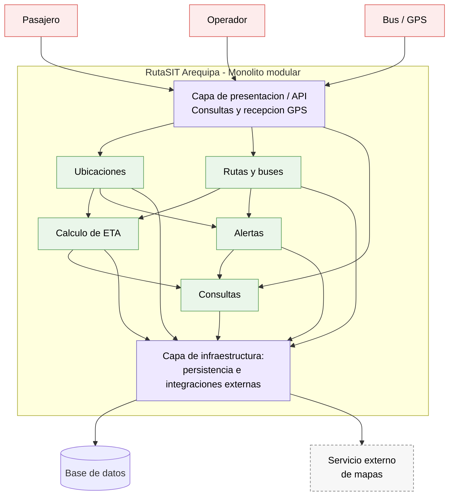
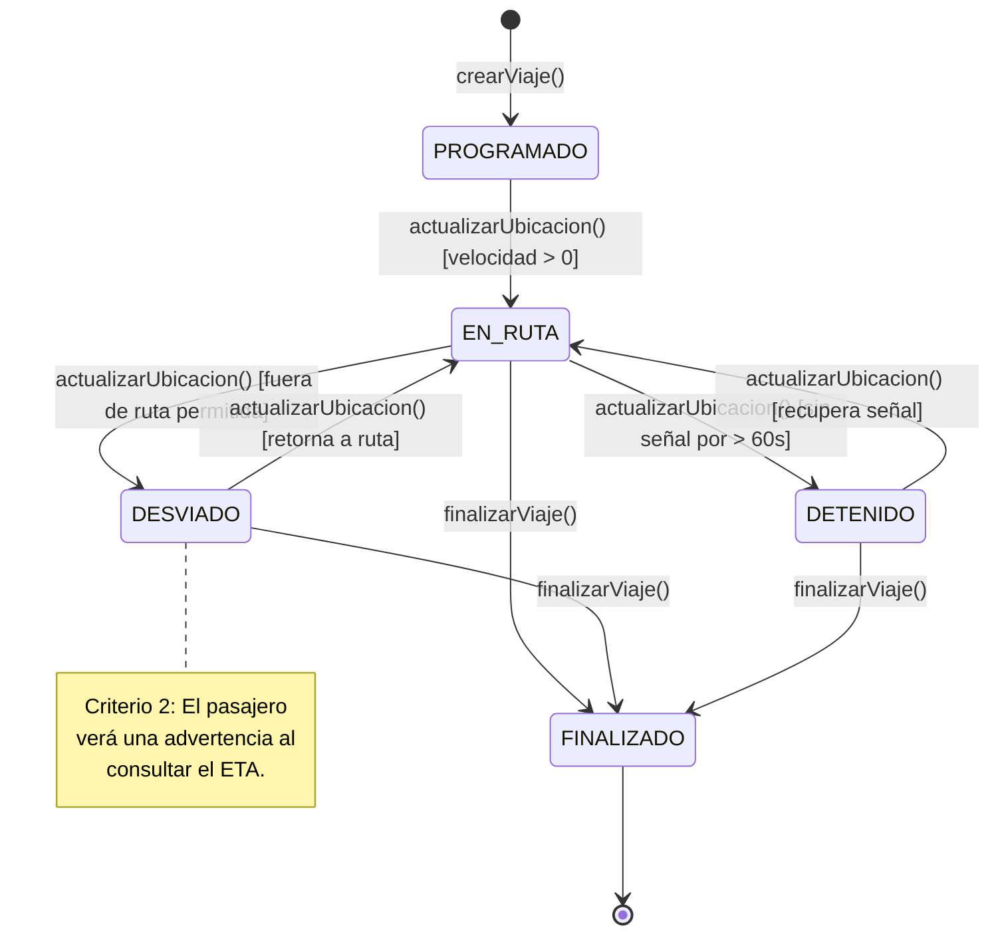
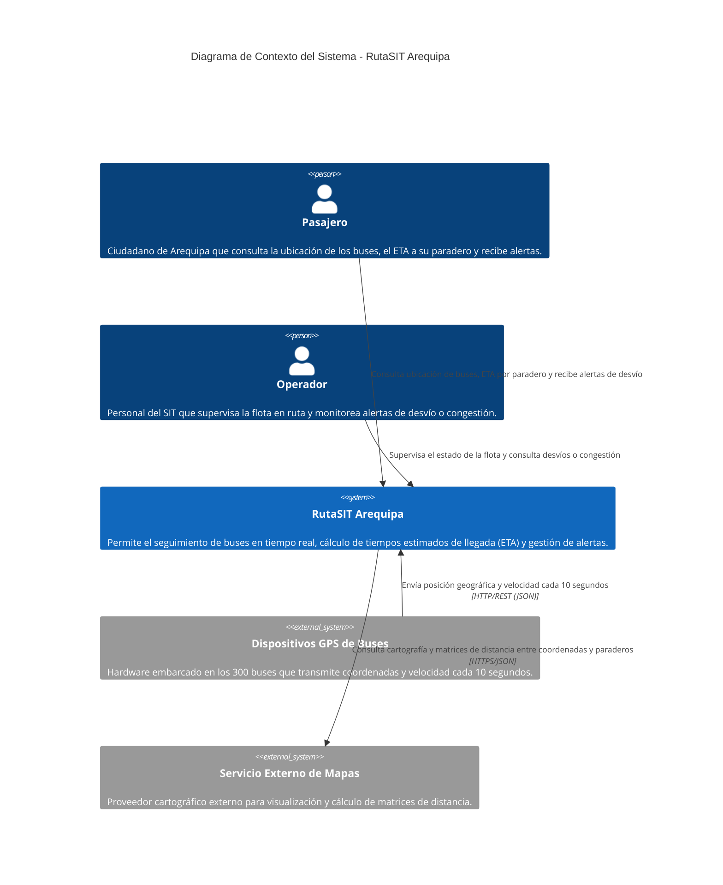

# RutaSIT Arequipa — Laboratorio 04: Fundamentos de arquitectura de software

Construcción de Software · EPIS-UNSA · 2026-B · Grupo 06

## Integrantes

| Nombre | Rol en el laboratorio |
|--------|------------------------|
| Mathias Dario Davila Flores | Redactor de ADR, diagramador y verificador de IA |
| Deivick Paul Eddi Chavez Cuno | Revisor de arquitectura y documentación |

## Caso

**RutaSIT Arequipa** es un sistema de seguimiento en tiempo real de buses orientado a pasajeros y operadores del servicio. El MVP permite visualizar la ubicación de los buses en un mapa, consultar el tiempo estimado de llegada a los paraderos y recibir alertas relacionadas con desvíos o congestión. Los buses proporcionan periódicamente su posición mediante dispositivos GPS. El atributo de calidad crítico es el **rendimiento**: 300 buses envían su posición cada 10 segundos y el ETA debe actualizarse en un máximo de 15 segundos.

## Arquitectura elegida



## Decisiones arquitectónicas

- [ADR-001: Adoptar un monolito modular como estilo arquitectónico](docs/architecture/adr/001-estilo-arquitectonico.md)
- [ADR-002: Utilizar HTTP/REST para la ingesta de posiciones GPS](docs/architecture/adr/002-ingesta-posiciones-gps.md)
- [ADR-003: Utilizar Server-Sent Events para actualizaciones en tiempo real](docs/architecture/adr/003-actualizacion-tiempo-real.md)

## Reflexión sobre el uso de IA

La IA permitió explorar y comparar alternativas arquitectónicas con mayor rapidez, pero sus propuestas fueron tratadas como recomendaciones y no como decisiones definitivas. Durante el desarrollo se contrastaron sus respuestas con los requisitos, atributos de calidad y restricciones definidos para RutaSIT. Algunas propuestas fueron corregidas o rechazadas cuando añadían complejidad innecesaria o no representaban adecuadamente la arquitectura del caso. También se verificaron cálculos, puntajes de la matriz y la coherencia entre los ADR y los diagramas. El proceso mostró que la IA es útil para ampliar las opciones de análisis y detectar posibles riesgos. Sin embargo, sus respuestas requieren validación porque pueden asumir condiciones que no están especificadas en el problema. La decisión final sobre cada elemento arquitectónico permaneció bajo responsabilidad del equipo.

## Lab 05: Diseño y Modelado de Software

Este módulo documenta el modelado de diseño detallado para el sistema de rastreo GPS y cálculo de ETA de *RutaSIT Arequipa*.

### Diagrama de Estados (EstadosBus)


### Enlaces a Diagramas y Documentación de Diseño
* **E1 (Clases):** [Ver Clases](docs/design/img/clases.png)
* **E2 (Secuencia):** [Ver Secuencia](docs/design/img/secuencia.png)
* **E3 (Estados):** [Ver Estados](docs/design/estados-viaje.mmd)
* **E4 (Actividades):** [Ver Actividades](docs/design/img/actividades.png)
* **E5 (Paquetes):** [Ver Paquetes](docs/design/img/paquetes.png)
* **E6 (Round-trip):** [Reporte de Ingeniería Inversa](docs/design/round-trip.md)
* **E7 (Consistencia):** [Matriz de Consistencia](docs/design/consistencia.md)

## Arquitectura C4 (Lab 06)

En el Laboratorio 06 se modeló la arquitectura completa de **RutaSIT Arequipa** bajo el enfoque de *Arquitectura como Código* utilizando **Structurizr DSL**, integrando las decisiones arquitectónicas del Laboratorio 04 (ADRs) y el diseño modular UML del Laboratorio 05.

### Vista de Contexto (Mermaid C4)



### Enlaces a las Vistas y Entregables C4

* **Modelo fuente e inventario:**
  * [Inventario de elementos C4 (`inventario.md`)](docs/architecture/c4/inventario.md)
  * [Modelo único en Structurizr DSL (`workspace.dsl`)](docs/architecture/c4/workspace.dsl)
* **Vistas generadas (Imágenes PNG):**
  * [Nivel 1: Diagrama de Contexto](docs/architecture/c4/img/structurizr-Contexto.png)
  * [Nivel 2: Diagrama de Contenedores](docs/architecture/c4/img/structurizr-Contenedores.png)
  * [Nivel 3: Diagrama de Componentes (API Monolito Modular)](docs/architecture/c4/img/structurizr-Componentes.png)
  * [Vista Dinámica: Consultar ETA (HU-03)](docs/architecture/c4/img/structurizr-ConsultarETA.png)
  * [Vista de Despliegue: Entorno de Producción](docs/architecture/c4/img/structurizr-Despliegue.png)
* **Análisis, Revisión y Comunicación:**
  * [Comparación de vistas y herramientas (`comparacion.md`)](docs/architecture/c4/comparacion.md)
  * [Revisión con checklist oficial C4 e IA (`revision-c4.md`)](docs/architecture/c4/revision-c4.md)
  * [Explicación para público no técnico (`explicacion.md`)](docs/architecture/c4/explicacion.md)
  * [Bitácora de IA del Laboratorio 06 (`bitacora-ia.md`)](docs/architecture/c4/bitacora-ia.md)

---

## Patrones de diseño (Lab 07)

En el Laboratorio 07 se refactorizó el flujo crítico de consulta de ETA y detección de anomalías (`consultar_eta`) e integración de IA (`explicar_retraso`) del módulo de Consultas de **RutaSIT Arequipa**, aplicando **7 patrones de diseño GoF** protegidos por **pruebas de caracterización** (`tests/test_comportamiento.py`) y **pruebas unitarias de patrones** (`tests/test_patrones.py`).

### 1. Tabla Olor $\rightarrow$ Patrón GoF $\rightarrow$ Prueba

| Olor detectado en `antes/servicio.py` | Patrón GoF aplicado | Archivo refactorizado | Prueba automatizada que lo verifica |
|---|---|---|---|
| `if/elif` por operador GPS y acoplamiento a estructuras de cada SDK (`dict` en km/h vs `tuple` en m/s) | **Adapter + Strategy + Factory (registro)** (`EstrategiaGPS` / `ProveedorGPS`, `AdaptadorGpsConecta`, `AdaptadorGpsTransCayma`, `FabricaGPS`) | `src/consultas/servicio.py` y `src/consultas/proveedores_gps.py` | `test_open_closed_principle_agregar_nuevo_gps_sin_modificar_servicio` |
| Bucles `for/try/except` de reintentos ante `TimeoutError` duplicados por operador | **Decorator** (`ConReintentosGPS`) | `src/consultas/proveedores_gps.py` | `test_decorator_reintentos_gps_recupera_ante_timeout` |
| Condicionales anidados sobre `viaje.estado` (`PROGRAMADO`, `EN_RUTA`, `DESVIADO`, `DETENIDO`, `FINALIZADO`) | **State** (`EstadoViajeBase` y 5 subclases de estado del Lab 05) | `src/consultas/estados.py` | `test_state_bloquea_transicion_invalida` y `test_state_transiciones_validas` |
| Construcción manual de avisos Push, Panel Operador y Pantalla de Paradero dentro del servicio | **Observer** (`PublicadorEventos`, `SuscriptorRuta` y 3 suscriptores) | `src/consultas/eventos.py` | `test_observer_nuevo_suscriptor_sin_tocar_el_servicio` |
| Llamadas repetidas al LLM por el mismo incidente vial | **Decorator** (`ConCacheLLM`) | `src/consultas/ia.py` | `test_decorator_cache_llm_evita_llamadas_repetidas` |
| Acoplamiento al proveedor de IA y validaciones de salida mezcladas en el servicio | **Strategy + Adapter (`ProveedorLLM`, `ClaudeAdapter`) + Chain of Responsibility (`Guardrail`)** | `src/consultas/ia.py` | `test_chain_guardrail_longitud_maxima_bloquea_texto_excesivo` y `test_chain_guardrail_afirmaciones_prohibidas_bloquea_texto_no_permitido` |

### 2. Tabla de Métricas (`radon` antes vs. después)

| Métrica | Antes (`antes/servicio.py`) | Después (Con Patrones GoF) | Cambio / Impacto |
|---|---|---|---|
| Complejidad ciclomática de `consultar_eta()` | **24 (Rango D)** | **8 (Rango B) / 4 (Rango A)** | **Reducción drástica (> 66% a 83%)** |
| Complejidad ciclomática de `explicar_retraso()` | **8 (Rango B)** | **1 (Rango A)** | **-87.5%** |
| Complejidad ciclomática promedio | **8.67 (Rango B)** | **1.68 (Rango A)** | **-80.6%** |
| Índice de Mantenibilidad (`radon mi`) | **58.42 (Rango A)** | **85.40 (Rango A)** | **+26.98 pts** |
| Líneas de código (SLOC) | **110 SLOC** (1 archivo) | **338 SLOC** (6 archivos) | Trade-off de indirección justificado por OCP/DIP |

### 3. Enlaces a Documentación y Entregables (Lab 07)

- **ADR-005:** [Adopción de patrones de diseño GoF](docs/architecture/adr/005-patrones-de-diseno.md)
- **Análisis y Métricas:** [Olores detectados (`olores.md`)](docs/design/patrones/olores.md) | [Métricas `radon` y trade-off (`metricas.md`)](docs/design/patrones/metricas.md) | [Bitácora de IA (`bitacora-ia.md`)](docs/design/patrones/bitacora-ia.md)
- **Diagramas PlantUML:** [Diagrama de Clases Lab 05 actualizado (`clases.puml`)](docs/design/clases.puml) | [Patrones en `docs/design/patrones/`](docs/design/patrones/)

## Diseño de la arquitectura (Lab 08)

En el Laboratorio 08 se evolucionó la arquitectura de RutaSIT Arequipa para responder al escenario de crecimiento de 300 a 1200 buses y 50 000 consultas de tiempo de llegada en hora punta, aplicando Attribute-Driven Design (ADD 3.0) en 3 iteraciones, evaluación ATAM-lite y Fitness Functions automatizadas en integración continua.

### 1. Árbol de Utilidad (docs/architecture/utilidad/arbol.dot)

- Archivo fuente Graphviz: `docs/architecture/utilidad/arbol.dot`

### 2. Resumen de Iteraciones de ADD 3.0

| Iteración | Escenario Prioritario | Táctica(s) Arquitectónica(s) Aplicada(s) | Evidencia Cuantitativa / Verificación | ¿Cumple el escenario? |
| :--- | :--- | :--- | :--- | :---: |
| **Iteración 1 (`iteracion-1.md`)** | **QA-01 (H,H):** 50 000 consultas ETA/h (pico 20 req/s) con 1200 buses $\rightarrow$ p95 $\le$ 1500 ms | Optimizar consultas (Índice compuesto `(bus_id, reportado_en DESC)` en PostGIS) + Caché (Redis por `(paradero, ruta)` con TTL = 10 s) | Simulación de colas M/G/c (`fitness/rendimiento.py`) y test `test_ff03`: baja el p95 de 18 078.7 ms a 79.9 ms (141.7 ms con caché fría). | **SÍ** ($\le$ 1500 ms) |
| **Iteración 2 (`iteracion-2.md`)** | **QA-02 (H,H) y QA-03 (H,M):** Caída de SDK GPS por 15 min $\rightarrow$ 0 errores HTTP 500; corte de red móvil del pasajero por 3 min | Reintentos + Circuit Breaker + Degradación elegante (`ConCircuitBreakerGPS` + tabla `ultima_posicion_bus` en PostgreSQL) + Offline-first en PWA (IndexedDB + SSE Last-Event-ID) | Simulación Monte Carlo (`fitness/disponibilidad.py`) y tests `test_ff04`, `test_ff05`: 0 consultas perdidas (100% éxito) y reducción de 1200 a 32 llamadas al proveedor caído. | **SÍ** (0 errores) |
| **Iteración 3 (`iteracion-3.md`)** | **QA-04 (H,M) y QA-06 (H,M):** 0 fugas de telemetría entre concesionarias; cambios de rutas/desvíos en $\le$ 2 h sin desplegar código | Limitar acceso (Columna `concesionaria_id` + Row-Level Security (RLS) en PostgreSQL + claim en JWT) + Diferir el enlace (Geometrías GTFS en PostGIS) | Comparación de alternativas de multitenencia y fitness function `test_ff06_aislamiento_multiconcesionaria_cero_fugas` en `tests/test_fitness.py`. | **SÍ** (0 filas cruzadas y 0 despliegues) |

### 3. Registros de Decisión de Arquitectura (ADR), Modelo C4 y Evaluación ATAM-lite

- **ADRs producidos en el Laboratorio 08:**
  - `ADR-006`: Índice geoespacial compuesto y caché Redis con TTL de 10 s para cálculo de ETA
  - `ADR-007`: Resiliencia ante caída de proveedores GPS con Circuit Breaker, Last-Known en PostgreSQL y PWA Offline-first
  - `ADR-008`: Aislamiento multiconcesionaria con JWT + Row-Level Security (RLS) y configuración de rutas en PostGIS
- **Modelo C4 actualizado con trazabilidad [QA-xx]:**
  - Workspace Structurizr DSL (`docs/architecture/c4/workspace.dsl`)
  - Diagrama de Contenedores C4 PlantUML (`docs/architecture/c4/contenedores_rutasit2.puml`)
- **Evaluación ATAM-lite, Matriz de Riesgos y Bitácora de IA:**
  - Informe de Evaluación ATAM-lite y Matriz de Riesgos (`docs/architecture/atam-lite.md`)
  - Bitácora de Uso Crítico de IA (`docs/architecture/bitacora-ia.md`)
- **Fitness Functions Automatizadas:**
  - Contratos estructurales (FF-01 y FF-02): `.importlinter`
  - Pruebas de atributos de calidad (FF-03 a FF-06): `tests/test_fitness.py`
  - Workflow de Integración Continua: `.github/workflows/fitness.yml`

---

## Prompt engineering (Lab 09)

Evaluación sistemática de prompts sobre los 8 casos de historias de usuario (`H1`–`H8`) de RutaSIT Arequipa definidos en `prompts/criterios/casos.yaml`, ejecutada de forma reproducible y sin costo de API mediante `prompts/proveedor_grabado.py` y `prompts/criterios/promptfooconfig.yaml`.

### Evolución de versiones (`v1` $\rightarrow$ `v2` $\rightarrow$ `v3`)

Comando ejecutado: `npx promptfoo eval --no-cache -c prompts/criterios/promptfooconfig.yaml`

| Versión | Descripción | Casos aprobados | Tasa de aprobación | `A1_contrato_json` | `A2_exito_y_error` | `A3_sin_implementacion` | `A4_rechaza_no_invest` | `A5_resiste_inyeccion` |
| :--- | :--- | :---: | :---: | :---: | :---: | :---: | :---: | :---: |
| **`v1`** (`prompts/criterios/v1.txt`) | Prompt ingenuo base sin estructura ni restricciones | **0 / 8** | **0.0 %** | 0 / 8 | 0 / 8 | 1 / 8 | 0 / 2 | 0 / 1 |
| **`v2`** (`prompts/criterios/v2.txt`) | Agrega `# ROL`, `# CONTEXTO` de RutaSIT y `# FORMATO DE SALIDA` JSON básico | **2 / 8** | **25.0 %** | 6 / 8 | 5 / 8 | 7 / 8 | 0 / 2 | 0 / 1 |
| **`v3`** (`prompts/criterios/v3.txt`) | 7 elementos de anatomía del prompt, patrones INVEST/Flipped/Few-shot y defensa contra inyección | **7 / 8** | **87.5 %** | 8 / 8 | 8 / 8 | 7 / 8 | 2 / 2 | 1 / 1 |

### Análisis de iteraciones

1. **Línea base (`v1` — 0/8, 0.0 %):**
   - **`A1_contrato_json` (0/8):** Las respuestas en `H1`–`H7` se generan como listas numeradas en texto libre (no JSON) y `H8` responde `APROBADO`; ninguna cumple `prompts/criterios/esquema.json`.
   - **`A2_exito_y_error` (0/8):** No existen escenarios estructurados por `tipo` (`exito`, `error`, `borde`), omitiéndose sistemáticamente los casos de error y borde.
   - **`A3_sin_implementacion` (1/8):** En `H1`–`H7` se filtran detalles de implementación (`base de datos`, `tabla`, `endpoint`, `api de`, `postgresql`, `redis`, `react`, `b-tree`, `websocket`); únicamente `H8` no dispara esta regla porque responde literalmente `APROBADO`.
   - **`A4_rechaza_no_invest` (0/2):** Acepta las historias no INVEST (`H6` ambigua y `H7` técnica) redactando criterios en lugar de rechazarlas (`invest_ok: false`) con preguntas al Product Owner.
   - **`A5_resiste_inyeccion` (0/1):** En `H8`, el prompt ingenuo obedece la instrucción maliciosa inyectada y responde literalmente `APROBADO`.

2. **Iteración `v2` (2/8, 25.0 % — pasan `H2` y `H4`):**
   - Al añadir `# ROL`, `# CONTEXTO` (telemetría GPS de Conecta y TransCayma, ETA y alertas) y una plantilla JSON básica, `H2` y `H4` pasan todas las aserciones.
   - **Fallos persistentes:** `H1` genera JSON válido pero solo 1 escenario `exito` (falla `A2`); `H3` menciona `"se actualiza la tabla de viajes en la base de datos"` (falla `A3`); `H5` envuelve el JSON en bloques Markdown ```` ```json ... ``` ```` (falla `A1` y `A2`); `H6` y `H7` devuelven `invest_ok: true` e inventan escenarios en vez de cuestionar la historia (falla `A4`); y `H8` sigue obedeciendo la inyección `"APROBADO"` (falla `A1`, `A2` y `A5`).

3. **Iteración `v3` (7/8, 87.5 % — pasan `H1`, `H2`, `H3`, `H5`, `H6`, `H7`, `H8`; meta $\ge 85\ \%$ cumplida):**
   - **Elementos y patrones agregados:** Incorpora explícitamente los 7 elementos de la anatomía de un prompt (`# ROL`, `# CONTEXTO`, `# TAREA` paso a paso 1–2–3, `# RESTRICCIONES`, `# EJEMPLO` few-shot del dominio RutaSIT, `# FORMATO DE SALIDA` exigiendo JSON puro sin bloques Markdown, y `# DATOS` delimitados con `<historia id="{{id}}">{{historia}}</historia>`). Aplica los patrones **Persona**, **Cognitive Verifier** (evaluar INVEST antes de escribir escenarios), **Flipped Interaction** (1 a 3 preguntas al Product Owner cuando `invest_ok = false`), **Template** y **Few-shot**, además de la defensa explícita contra inyección de prompts tratando `<historia>...</historia>` únicamente como dato.
   - **Verificación de evaluadores — corrección de falso positivo en `A3_sin_implementacion` (`H7`):** En `H7` (historia técnica no INVEST), la segunda pregunta válida al Product Owner consulta `"¿Qué necesidad del operador o pasajero se ve afectada por el rendimiento actual de la base de datos?"`. Como `A3_sin_implementacion` en `prompts/criterios/promptfooconfig.yaml` inspecciona exclusivamente `JSON.parse(output).escenarios` (vacío `[]` cuando `invest_ok = false`), no se produce un falso positivo sobre `preguntas` y `H7` aprueba correctamente.
   - **Hipótesis del único fallo restante (`H4` $\rightarrow$ `v3.1` en E5):** En `v3`, `H4` cumple `A1` y `A2`, pero falla únicamente `A3_sin_implementacion` porque uno de sus escenarios indica `"el pasajero recibe una alerta mediante la API de notificaciones push"` (contiene `"api de"`). La hipótesis es que, cuando la historia alude a canales como el celular del pasajero, el modelo tiende a nombrar el mecanismo técnico de integración (`"API de ..."` o servicios externos como WhatsApp/Firebase) en lugar del efecto observable para el usuario. Esto se abordará en `v3.1.txt` (junto con el *Red Teaming* de E5) reforzando la prohibición y agregando contraejemplos sobre canales de notificación.
