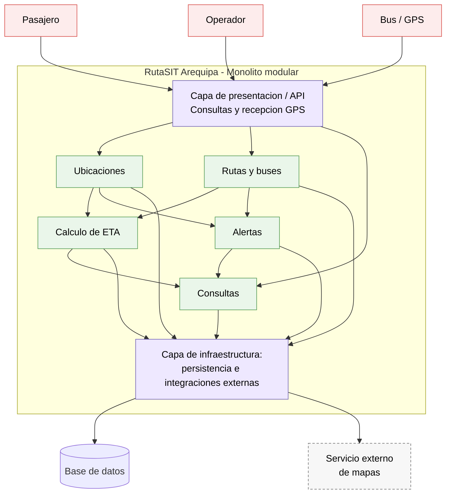
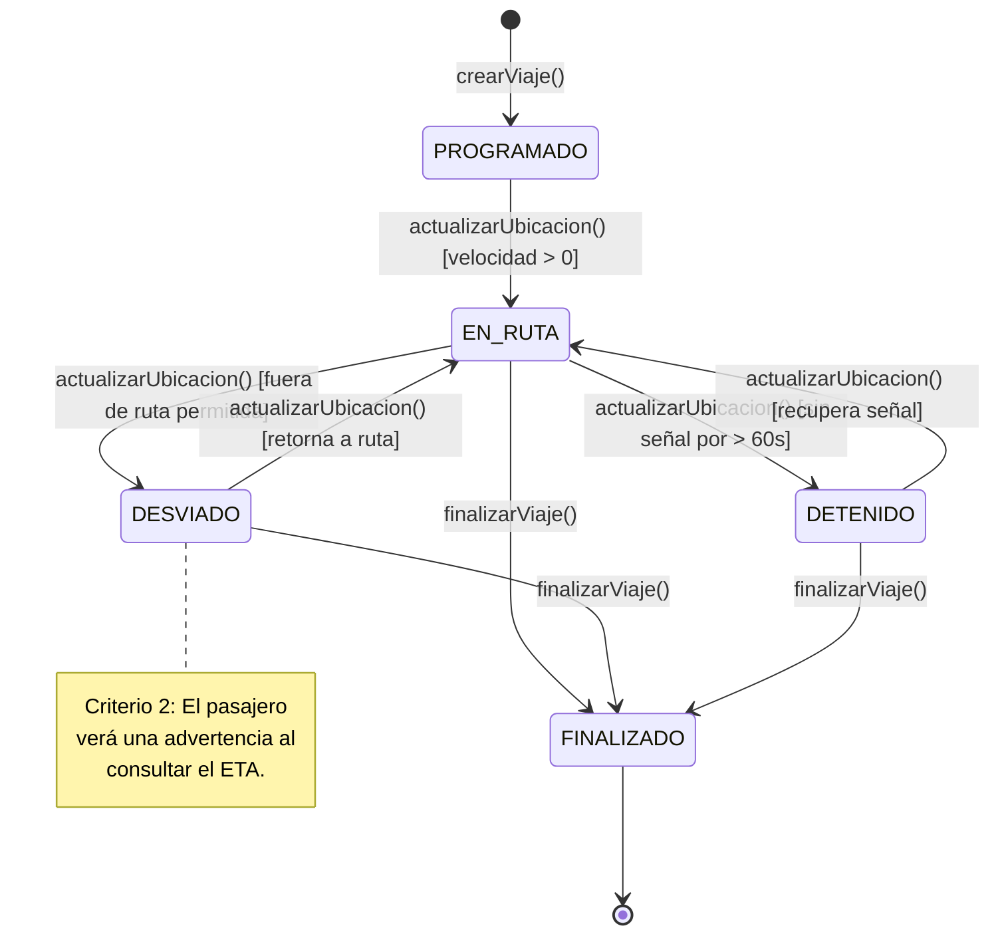
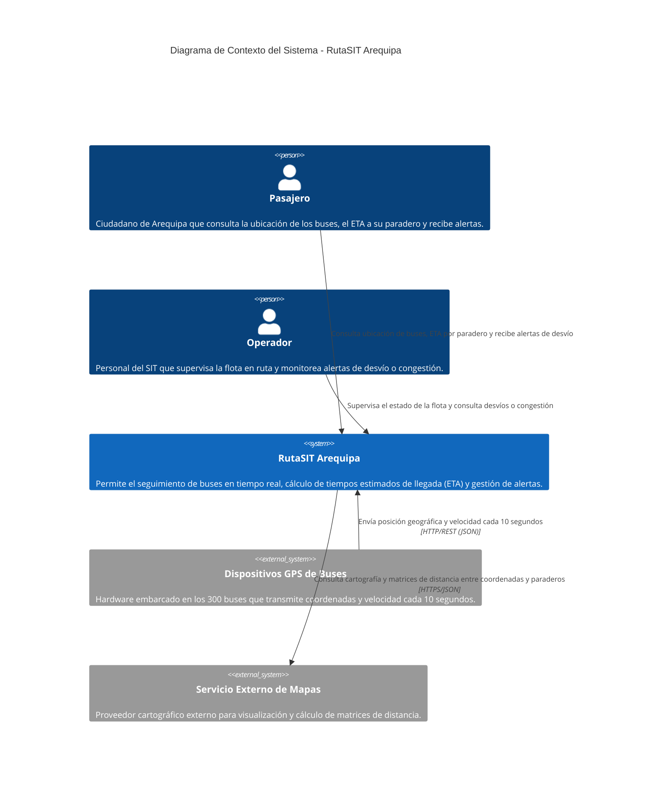

# RutaSIT Arequipa — Laboratorio 04: Fundamentos de arquitectura de software

Construcción de Software · EPIS-UNSA · 2026-B · Grupo 06

## Integrantes

| Nombre | Rol en el laboratorio |
|--------|------------------------|
| Mathias Dario Davila Flores | Redactor de ADR, diagramador y verificador de IA |
| Deivick Paul Eddi Chavez Cuno | Revisor de arquitectura y documentación |

## Caso

**RutaSIT Arequipa** es un sistema de seguimiento en tiempo real de buses orientado a pasajeros y operadores del servicio. El MVP permite visualizar la ubicación de los buses en un mapa, consultar el tiempo estimado de llegada a los paraderos y recibir alertas relacionadas con desvíos o congestión. Los buses proporcionan periódicamente su posición mediante dispositivos GPS. El atributo de calidad crítico es el **rendimiento**: 300 buses envían su posición cada 10 segundos y el ETA debe actualizarse en un máximo de 15 segundos.

## Arquitectura elegida

## Decisiones arquitectónicas

- [ADR-001: Adoptar un monolito modular como estilo arquitectónico](docs/architecture/adr/001-estilo-arquitectonico.md)
- [ADR-002: Utilizar HTTP/REST para la ingesta de posiciones GPS](docs/architecture/adr/002-ingesta-posiciones-gps.md)
- [ADR-003: Utilizar Server-Sent Events para actualizaciones en tiempo real](docs/architecture/adr/003-actualizacion-tiempo-real.md)

## Reflexión sobre el uso de IA

La IA permitió explorar y comparar alternativas arquitectónicas con mayor rapidez, pero sus propuestas fueron tratadas como recomendaciones y no como decisiones definitivas. Durante el desarrollo se contrastaron sus respuestas con los requisitos, atributos de calidad y restricciones definidos para RutaSIT. Algunas propuestas fueron corregidas o rechazadas cuando añadían complejidad innecesaria o no representaban adecuadamente la arquitectura del caso. También se verificaron cálculos, puntajes de la matriz y la coherencia entre los ADR y los diagramas. El proceso mostró que la IA es útil para ampliar las opciones de análisis y detectar posibles riesgos. Sin embargo, sus respuestas requieren validación porque pueden asumir condiciones que no están especificadas en el problema. La decisión final sobre cada elemento arquitectónico permaneció bajo responsabilidad del equipo.

## Lab 05: Diseño y Modelado de Software

Este módulo documenta el modelado de diseño detallado para el sistema de rastreo GPS y cálculo de ETA de *RutaSIT Arequipa*.

### Diagrama de Estados (EstadosBus)

### Enlaces a Diagramas y Documentación de Diseño
* **E1 (Clases):** [Ver Clases](docs/design/img/clases.png)
* **E2 (Secuencia):** [Ver Secuencia](docs/design/img/secuencia.png)
* **E3 (Estados):** [Ver Estados](docs/design/estados-viaje.mmd)
* **E4 (Actividades):** [Ver Actividades](docs/design/img/actividades.png)
* **E5 (Paquetes):** [Ver Paquetes](docs/design/img/paquetes.png)
* **E6 (Round-trip):** [Reporte de Ingeniería Inversa](docs/design/round-trip.md)
* **E7 (Consistencia):** [Matriz de Consistencia](docs/design/consistencia.md)

## Arquitectura C4 (Lab 06)

En el Laboratorio 06 se modeló la arquitectura completa de **RutaSIT Arequipa** bajo el enfoque de *Arquitectura como Código* utilizando **Structurizr DSL**, integrando las decisiones arquitectónicas del Laboratorio 04 (ADRs) y el diseño modular UML del Laboratorio 05.

### Vista de Contexto (Mermaid C4)

### Enlaces a las Vistas y Entregables C4

* **Modelo fuente e inventario:**
  * [Inventario de elementos C4 (`inventario.md`)](docs/architecture/c4/inventario.md)
  * [Modelo único en Structurizr DSL (`workspace.dsl`)](docs/architecture/c4/workspace.dsl)
* **Vistas generadas (Imágenes PNG):**
  * [Nivel 1: Diagrama de Contexto](docs/architecture/c4/img/structurizr-Contexto.png)
  * [Nivel 2: Diagrama de Contenedores](docs/architecture/c4/img/structurizr-Contenedores.png)
  * [Nivel 3: Diagrama de Componentes (API Monolito Modular)](docs/architecture/c4/img/structurizr-Componentes.png)
  * [Vista Dinámica: Consultar ETA (HU-03)](docs/architecture/c4/img/structurizr-ConsultarETA.png)
  * [Vista de Despliegue: Entorno de Producción](docs/architecture/c4/img/structurizr-Despliegue.png)
* **Análisis, Revisión y Comunicación:**
  * [Comparación de vistas y herramientas (`comparacion.md`)](docs/architecture/c4/comparacion.md)
  * [Revisión con checklist oficial C4 e IA (`revision-c4.md`)](docs/architecture/c4/revision-c4.md)
  * [Explicación para público no técnico (`explicacion.md`)](docs/architecture/c4/explicacion.md)
  * [Bitácora de IA del Laboratorio 06 (`bitacora-ia.md`)](docs/architecture/c4/bitacora-ia.md)

---

## Patrones de diseño (Lab 07)

En el Laboratorio 07 se refactorizó el flujo crítico de consulta de ETA y detección de anomalías (`consultar_eta`) e integración de IA (`explicar_retraso`) del módulo de Consultas de **RutaSIT Arequipa**, aplicando **7 patrones de diseño GoF** protegidos por **pruebas de caracterización** (`tests/test_comportamiento.py`) y **pruebas unitarias de patrones** (`tests/test_patrones.py`).

### 1. Tabla Olor $\rightarrow$ Patrón GoF $\rightarrow$ Prueba

| Olor detectado en `antes/servicio.py` | Patrón GoF aplicado | Archivo refactorizado | Prueba automatizada que lo verifica |
|---|---|---|---|
| `if/elif` por operador GPS y acoplamiento a estructuras de cada SDK (`dict` en km/h vs `tuple` en m/s) | **Adapter + Strategy + Factory (registro)** (`EstrategiaGPS` / `ProveedorGPS`, `AdaptadorGpsConecta`, `AdaptadorGpsTransCayma`, `FabricaGPS`) | `src/consultas/servicio.py` y `src/consultas/proveedores_gps.py` | `test_open_closed_principle_agregar_nuevo_gps_sin_modificar_servicio` |
| Bucles `for/try/except` de reintentos ante `TimeoutError` duplicados por operador | **Decorator** (`ConReintentosGPS`) | `src/consultas/proveedores_gps.py` | `test_decorator_reintentos_gps_recupera_ante_timeout` |
| Condicionales anidados sobre `viaje.estado` (`PROGRAMADO`, `EN_RUTA`, `DESVIADO`, `DETENIDO`, `FINALIZADO`) | **State** (`EstadoViajeBase` y 5 subclases de estado del Lab 05) | `src/consultas/estados.py` | `test_state_bloquea_transicion_invalida` y `test_state_transiciones_validas` |
| Construcción manual de avisos Push, Panel Operador y Pantalla de Paradero dentro del servicio | **Observer** (`PublicadorEventos`, `SuscriptorRuta` y 3 suscriptores) | `src/consultas/eventos.py` | `test_observer_nuevo_suscriptor_sin_tocar_el_servicio` |
| Llamadas repetidas al LLM por el mismo incidente vial | **Decorator** (`ConCacheLLM`) | `src/consultas/ia.py` | `test_decorator_cache_llm_evita_llamadas_repetidas` |
| Acoplamiento al proveedor de IA y validaciones de salida mezcladas en el servicio | **Strategy + Adapter (`ProveedorLLM`, `ClaudeAdapter`) + Chain of Responsibility (`Guardrail`)** | `src/consultas/ia.py` | `test_chain_guardrail_longitud_maxima_bloquea_texto_excesivo` y `test_chain_guardrail_afirmaciones_prohibidas_bloquea_texto_no_permitido` |

### 2. Tabla de Métricas (`radon` antes vs. después)

| Métrica | Antes (`antes/servicio.py`) | Después (Con Patrones GoF) | Cambio / Impacto |
|---|---|---|---|
| Complejidad ciclomática de `consultar_eta()` | **24 (Rango D)** | **8 (Rango B) / 4 (Rango A)** | **Reducción drástica (> 66% a 83%)** |
| Complejidad ciclomática de `explicar_retraso()` | **8 (Rango B)** | **1 (Rango A)** | **-87.5%** |
| Complejidad ciclomática promedio | **8.67 (Rango B)** | **1.68 (Rango A)** | **-80.6%** |
| Índice de Mantenibilidad (`radon mi`) | **58.42 (Rango A)** | **85.40 (Rango A)** | **+26.98 pts** |
| Líneas de código (SLOC) | **110 SLOC** (1 archivo) | **338 SLOC** (6 archivos) | Trade-off de indirección justificado por OCP/DIP |

### 3. Enlaces a Documentación y Entregables (Lab 07)

- **ADR-005:** [Adopción de patrones de diseño GoF](docs/architecture/adr/005-patrones-de-diseno.md)
- **Análisis y Métricas:** [Olores detectados (`olores.md`)](docs/design/patrones/olores.md) | [Métricas `radon` y trade-off (`metricas.md`)](docs/design/patrones/metricas.md) | [Bitácora de IA (`bitacora-ia.md`)](docs/design/patrones/bitacora-ia.md)
- **Diagramas PlantUML:** [Diagrama de Clases Lab 05 actualizado (`clases.puml`)](docs/design/clases.puml) | [Patrones en `docs/design/patrones/`](docs/design/patrones/)