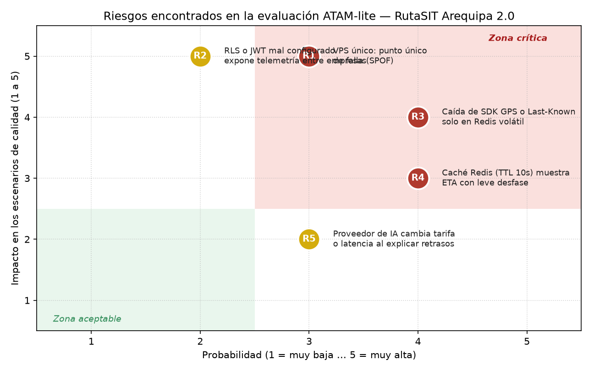

# Evaluación Arquitectónica ATAM-lite — RutaSIT Arequipa 2.0 (E3 y E7)

## 1. Hallazgos de la Evaluación ATAM-lite (Propios y Evaluación Cruzada Recibida)

| Tipo de Hallazgo | Escenario | Descripción del Hallazgo / Pregunta del Evaluador | Respuesta del Equipo (Aceptación o Refutación con Evidencia) |
|---|---|---|---|
| **Punto de sensibilidad** | `QA-01` | El $\text{p95}$ de `consultar_eta()` a $20\text{ req/s}$ depende de la tasa de aciertos de la caché Redis si la base de datos no está indexada (supera $1500\text{ ms}$ cuando los aciertos caen por debajo del $35\%$). | **Confirmado por simulación (`fitness/rendimiento.py`):** Por eso no adoptamos solo caché; agregamos el índice compuesto `(bus_id, reportado_en DESC)` que mantiene el $\text{p95}$ en **$141.7\text{ ms}$** incluso con $0\%$ de aciertos en caché (`ADR-006`). |
| **Punto de trade-off** | `QA-01` | La caché de ETA en Redis (`TTL = 10 s`) mejora drásticamente la latencia ($\text{p95} = 79.9\text{ ms}$), pero afecta la frescura del tiempo estimado entregado al pasajero. | **Aceptado (`ADR-006`):** Como los 1200 buses transmiten su posición GPS cada 10 segundos, un TTL de 10 s está alineado con la frecuencia física del sensor y no degrada la utilidad para el pasajero. |
| **Punto de trade-off** | `QA-02` | El Circuit Breaker con fallback a la tabla `ultima_posicion_bus` logra 0 errores HTTP 500 durante caídas del proveedor GPS, pero entrega una posición estimada que pierde frescura conforme pasan los minutos. | **Aceptado (`ADR-007`):** Es preferible entregar la última posición válida con una alerta explícita (`"Bus sin señal reciente, ETA estimado"`) que devolver pantalla de error al ciudadano. |
| **Riesgo R1 (Zona Crítica: Prob=3, Imp=5)** | `QA-01`, `QA-02` | **Un solo VPS es punto único de falla (SPOF):** si la máquina virtual del proveedor cloud cae, tanto el monolito como Redis y PostgreSQL dejan de responder. *Pregunta incómoda: ¿Por qué no despliegan alta disponibilidad multi-nodo ahora?* | **Aceptado sin mitigar para el plazo de 1 mes:** Las restricciones de `drivers.md` fijan el presupuesto de 1 VPS y 1 mes de plazo. Se mitiga operativamente con snapshots automáticos diarios, `docker-compose restart: always` y un procedimiento de restauración en $< 1\text{ hora}$ (Plan B de segundo VPS documentado en `iteracion-1.md`). |
| **Riesgo R2 (Prob=2, Imp=5)** | `QA-04` | **Error en configuración de políticas RLS o validación de JWT** podría permitir que la concesionaria $A$ inyecte o lea telemetría de la concesionaria $B$. | **Mitigado (`ADR-008` y `E5`):** Protegido en cada Pull Request mediante la fitness function `test_ff06_aislamiento_multiconcesionaria_cero_fugas` que exige $0$ filas cruzadas. |
| **Riesgo R3 (Zona Crítica: Prob=4, Imp=4)** | `QA-02` | **Caída de 15 min de un SDK GPS externo o pérdida de Last-Known si se guarda solo en Redis volátil.** *Pregunta incómoda: ¿Qué pasa si Redis se reinicia mientras el proveedor GPS de ConectaAQP está caído?* | **Mitigado en la Iteración 2 (`ADR-007`):** Se descartó guardar el fallback solo en Redis y se implementó `ConCircuitBreakerGPS` + `RepositorioUltimaPosicion` persistido en PostgreSQL, logrando **0 consultas perdidas** y bajando de 1200 a 32 las llamadas al proveedor caído (`test_ff04` y `test_ff05`). |
| **Riesgo R4 (Zona Crítica: Prob=4, Imp=3)** | `QA-01` | **Caché de Redis muestra ETA con hasta 10 s de desfase** cuando un bus frena bruscamente por un incidente. | **Mitigado (`ADR-006`):** Se fijó un TTL corto de $10\text{ s}$ y, cuando el patrón Observer detecta un evento `"viaje_anomalo"` (`DESVIADO` o `DETENIDO`), invalida de inmediato la llave de esa ruta y publica la alerta por SSE. |
| **Riesgo R5 (Prob=3, Imp=2)** | `E5 (Lab 07)` | **Proveedor comercial de LLM cambia precios o sufre latencia** al explicar motivos de retraso. | **Mitigado desde Lab 07 (`ADR-005`):** El componente `ExplicadorRetrasosIA` está aislado detrás de `ProveedorLLM` con `ConCacheLLM` y cuenta con `LocalLLMAdapter` listo para conmutar. |
| **"Riesgo" Falso Positivo de la IA** | `QA-01` | La IA evaluadora afirmó: *"Server-Sent Events (SSE) y Python en un solo VPS colapsarán con 1200 buses; es obligatorio migrar a un clúster Apache Kafka + WebSockets bidireccionales"*. | **Refutado con evidencia (Falso Positivo):** 1200 buses reportando cada 10 s equivalen exactamente a $\frac{1200}{10} = 120\text{ eventos/s}$ de escritura ligera, y las consultas son unidireccionales (servidor $\rightarrow$ pasajero), caso ideal para SSE (`ADR-003`). Además, la simulación `fitness/rendimiento.py` demuestra un $\text{p95} = 79.9\text{ ms}$ en un solo VPS. Se solicitó evidencia numérica a la IA y no la tenía. |
| **No riesgo** | `QA-01`, `QA-07` | **El Monolito Modular (`ADR-001`) y los patrones GoF (`ADR-005`) soportan el crecimiento a 1200 buses y 50 000 consultas/h.** | **Respaldado por evidencia:** Simulación M/G/c ($\text{p95} = 79.9\text{ ms} \le 1500\text{ ms}$) y contratos de `import-linter` en verde. |

---

## 2. Matriz de Probabilidad e Impacto y Tratamiento de la Zona Crítica

### Resumen de decisiones para los 3 riesgos ubicados en la Zona Crítica (Roja):
1. **`R1` (VPS único como SPOF — Prob: 3, Imp: 5):** **Aceptado conscientemente** para el alcance de 1 mes por restricción presupuestaria (`drivers.md`), contando con backups automáticos diarios y el Plan B de escalar a 2 VPS (`8 workers`) ya simulado en `iteracion-1.md`.
2. **`R3` (Caída de SDK GPS y estado Last-Known — Prob: 4, Imp: 4):** **Mitigado en código y arquitectura (`ADR-007`)** mediante el decorador `ConCircuitBreakerGPS` y persistencia de la última ubicación en tabla de PostgreSQL, verificado en cada PR por `test_ff04` y `test_ff05`.
3. **`R4` (Desfase de caché de ETA — Prob: 4, Imp: 3):** **Mitigado por diseño (`ADR-006`)** limitando el TTL a $10\text{ s}$ (igual al periodo de muestreo GPS) e invalidando la llave ante eventos anómalos publicados por `PublicadorEventos`.